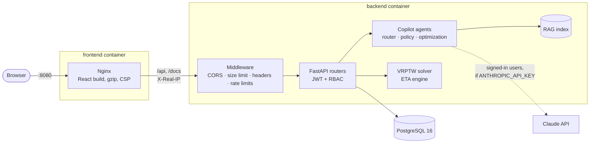
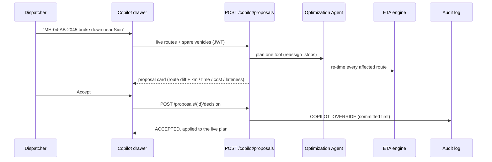

# AI Fleet Route Optimizer

An enterprise-grade, end-to-end AI solution for Fleet Route Optimization addressing operational efficiency, dynamic rerouting, regulatory compliance, and dispatch automation in the Logistics sector. The platform integrates deterministic graph optimization algorithms (DSA / VRPTW) with multi-agent generative AI (LangGraph) and RAG (Lewis et al., 2020 / WikiQA) grounded in verified logistics SOPs.

[](https://opensource.org/licenses/MIT)
[](https://www.python.org/downloads/)
[](https://fastapi.tiangolo.com)
[](https://react.dev)
[](https://vitejs.dev)
[-brightgreen.svg)]()
[](.github/workflows/ci.yml)
[]()
[](https://fleet-route-opt.onrender.com)
[](https://fleet-route-opt.vercel.app)

---

## 50-50 Balanced Engineering Division

The project is strictly split across two balanced engineering tracks covering both GenAI and Full-Stack development:

- **Track A (Manthan Nimodiya)**:
  - *GenAI / LLM*: Vector DB & Embeddings, RAG Knowledge Base (Logistics SOPs, Hazmat ADR/DOT, Driver Rest Mandates, WikiQA), Zero-Hallucination Guardrails, Confidence Scoring, LangGraph Optimization Agent.
  - *Full-Stack / Core*: Deterministic VRPTW Solver Core, Haversine Distance Matrix, Leaflet Map Polylines, Resequencing Workspace, Compliance Inspector Search UI, Fleet Models & CRUD APIs.

- **Track B (Abhayraj Jaiswal)**:
  - *GenAI / LLM*: LangGraph Multi-Agent StateGraph Architecture, Router Agent (Intent Classifier), Policy & Compliance Agent, AI Copilot Sliding Drawer UI & Execution Trace View, Structured Action Proposals.
  - *Full-Stack / Core*: Security & RBAC Auth Engine (JWT), In-Transit FSM & Telemetry Tracking, Mobile Driver View, Executive KPI Analytics Dashboard, Batch Order Ingestion Pipeline (CSV/JSON), Immutable Audit Logging.

---

## 16-Week Roadmap & Delivery Status

```
Track A Progress: [████████████████████] 100% (16 / 16 weeks delivered, Weeks 11–16 early)
Track B Progress: [████████████████████] 100% (16 / 16 weeks delivered, Weeks 11–16 early)
Month 1–4:        [████████████████████] 100% (Weeks 1–16 COMPLETED by both tracks)
```

| Milestone | Scope & Deliverables | Track A (Manthan Nimodiya) | Track B (Abhayraj Jaiswal) | Status |
| :--- | :--- | :--- | :--- | :---: |
| **Week 1** | **Foundations, Security & App Shell** | FastAPI Core, DB Engine, Health Probes | RBAC Auth, JWT Security, Command Center UI Shell | `COMPLETED` ✅ |
| **Week 2** | **Fleet Asset Management (US-001 & US-002)** | Fleet CRUD APIs, DB Models, Constraints | Interactive Fleet Workspace UI, Modals, Telemetry Cards | `COMPLETED` ✅ |
| **Week 3** | **RAG Knowledge Base & Shipment Engine** | Vector Store Engine & RAG Ingestion (US-006) | Shipment Models, APIs & Immutable Audit Log (US-002 & US-008) | `COMPLETED` ✅ |
| **Week 4** | **Batch Ingestion & Compliance UI** | RAG Compliance Inspector Search UI | Batch Order Uploader (CSV/JSON), Cluster Preview & Regression Tests | `COMPLETED` ✅ |
| **Week 5** | **Spatial Map & LangGraph Foundation** | Haversine Matrix & Leaflet Map Shell | LangGraph StateGraph & Router Agent (Intent Classifier) | `COMPLETED` ✅ |
| **Week 6** | **VRPTW Solver & In-Transit FSM** | Clarke-Wright + 2-opt VRPTW Solver | In-Transit FSM, Driver Actions & Telemetry | `COMPLETED` ✅ |
| **Week 7** | **Route Visualizer & Guardrails** | Route Planner, Colour-coded Polylines, Split Manifest | RAG Similarity Guardrails | `COMPLETED` ✅ |
| **Week 8** | **Resequencing & Policy Agent** | Drag-and-drop Resequencing, Violation Badges, Approve & Dispatch | Policy & Compliance Agent | `COMPLETED` ✅ |
| **Week 9** | **Optimization Agent & Driver View** | Tool-calling Optimization Agent (`/routes/disruption`) | Mobile Driver View | `COMPLETED` ✅ |
| **Week 10** | **Downstream ETAs & Copilot UI** | ETA Recalculation Engine & ETA Notifications | Copilot Drawer & Traces | `COMPLETED` ✅ |
| **Week 11** | **Route Explainer & Proposals** | RAG-grounded Route Explanations & Driver Instructions | Proposal Cards & Diff | `COMPLETED` ✅ |
| **Week 12** | **SLA Alerts & KPI Dashboard** | SLA Breach Detection, Alert Toasts & Sound | Executive KPI Dashboard | `COMPLETED` ✅ |
| **Week 13** | **Operational KPIs** | Metrics Engine (OTIF, Fuel, Cost per tonne-km) & Reports Page | Analytics Filters, Delivery Heatmap, CSV / PDF Executive Exports | `COMPLETED` ✅ |
| **Week 14** | **Data Export** | CSV & PDF Exports | Security Audit (RBAC, Rate Limits, Sanitisation, Headers), Audit Compliance Report, Agent Telemetry | `COMPLETED` ✅ |
| **Week 15** | **Performance** | Benchmark Script, Indexes, Performance Tests | Copilot Latency Benchmark, End-to-End Regression, Bundle Splitting, Responsive Layout | `COMPLETED` ✅ |
| **Week 16** | **Containerization & Release** | Backend Dockerfile, Postgres Compose, OpenAPI Polish | Frontend Docker + Nginx, Full-Stack Compose, CI, User Manual & API Reference | `COMPLETED` ✅ |

- **Automated Backend Test Suite**: `python -m pytest` → **234 / 234 PASSED (100%)**, including the end-to-end regression across US-001 to US-008, the security suite and the latency guards
- **Copilot Latency Benchmark**: `python -m scripts.benchmark_copilot` → worst p95 **15.9 ms** across every intent, proposal cards and 50 concurrent dispatchers (target < 3 s)
- **Performance Benchmark**: `python -m scripts.benchmark` → VRPTW 50 stops ≈ 3 ms (target < 5 s), agent re-route < 20 ms (target < 3 s)
- **RAG Retrieval Benchmark**: `python -m app.services.rag.evaluation` → **Recall@3 1.00 · MRR 0.98 · p95 < 1 ms** (WikiQA-style eval set)
- **Database Seeder**: `python scripts/seed_demo_data.py` → **Pre-loads 4 roles, 3 hubs, 4 vehicles, 5 drivers, 5 shipments, and audit logs**
- **Live Deployments**:
  - Backend API: [https://fleet-route-opt.onrender.com](https://fleet-route-opt.onrender.com) (FastAPI + PostgreSQL)
  - Frontend Web App: [https://fleet-route-opt.vercel.app](https://fleet-route-opt.vercel.app) (Vite + React 19 SPA)

---

## Architecture Overview

```
                                  +------------------------------------+
                                  |    Dispatch Operations Frontend    |
                                  |    React 19 + TypeScript + Vite    |
                                  +-----------------+------------------+
                                                    |  REST / JWT
                                                    v
                                  +------------------------------------+
                                  |         FastAPI Gateway            |
                                  |     Role-Based Access Control      |
                                  +--------+------------------+--------+
                                           |                  |
                    +----------------------+                  +----------------------+
                    |                                                                |
                    v                                                                v
     +------------------------------+                                 +------------------------------+
     |     Deterministic Core       |                                 |       Multi-Agent AI         |
     |                              |                                 |                              |
     | - VRPTW Solver (Clarke-      |                                 | - LangGraph StateGraph       |
     |   Wright + 2-opt Heuristic)  |                                 | - Router Agent (Intent)      |
     | - Haversine Distance Engine  |                                 | - Policy & Compliance Agent  |
     | - PostgreSQL / SQLAlchemy    |                                 | - Optimization Agent (Tools) |
     | - In-Transit FSM Lifecycle   |                                 | - Zero-Hallucination Guard   |
     +------------------------------+                                 +--------------+---------------+
                                                                                     |
                                                                                     v
                                                                      +------------------------------+
                                                                      |      RAG Knowledge Base      |
                                                                      |                              |
                                                                      | - Vector Store (Embeddings)  |
                                                                      | - Logistics SOPs & Hazmat    |
                                                                      | - Driver Rest Break Rules    |
                                                                      | - Citation & Scoring Engine  |
                                                                      +------------------------------+
```

### Deployment (Docker Compose)



### Request path for a copilot disruption



---

## Directory Structure

```
fleet-route-opt/
├── backend/
│   ├── app/
│   │   ├── api/v1/
│   │   │   ├── auth.py                  # [Track B] JWT authentication & role-based access
│   │   │   ├── fleet.py                 # [Track A] Vehicle, Driver, Hub CRUD & capacity
│   │   │   ├── health.py                # [Track A] Health & readiness probes
│   │   │   ├── rag.py                   # [Track A] Semantic policy search & benchmark
│   │   │   ├── shipments.py             # [Track B] Shipment CRUD & batch ingestion
│   │   │   ├── audit.py                 # [Track B] Immutable audit trail query API
│   │   │   ├── routes.py                # [Track A] Distance matrix, optimize, evaluate, recalculate, SLA, explain, disruption
│   │   │   ├── reports.py               # [Track A] Metrics, CSV & PDF exports
│   │   │   ├── analytics.py             # [Track B] Executive KPIs, CSV / PDF executive exports
│   │   │   ├── copilot.py               # [Track B] Copilot query, proposals, policy agent, telemetry
│   │   │   ├── transit.py               # [Track B] In-transit FSM and driver manifest
│   │   │   └── router.py                # Central API router aggregator
│   │   ├── core/                        # Configuration, database, JWT security
│   │   │   ├── http_security.py         # [Track B] Rate limits, security headers, body-size limit
│   │   │   └── sanitize.py              # [Track B] Input sanitisation types
│   │   ├── models/                      # SQLAlchemy 2.0 ORM models
│   │   ├── schemas/                     # Pydantic v2 validation models
│   │   └── services/
│   │       ├── audit_service.py         # Forensic state diff audit logger
│   │       ├── audit_report.py          # [Track B] Compliance checks, audit CSV / PDF
│   │       ├── executive_analytics.py   # [Track B] Executive KPIs, filters, delivery density
│   │       ├── executive_exports.py     # [Track B] Executive CSV / PDF
│   │       ├── batch_ingestion.py       # High-throughput CSV/JSON parser
│   │       ├── rag/                     # Vector store, corpus, embeddings, evaluation
│   │       ├── optimizer/               # [Track A] Distance matrix, VRPTW solver, ETA engine, route explainer
│   │       ├── copilot/                 # Router agent, state graph [B]; optimization agent [A]
│   │       └── analytics/               # [Track A] Metrics engine, simulated history, exports
│   ├── scripts/
│   │   ├── seed_demo_data.py            # Automated database seeder
│   │   ├── benchmark.py                 # [Track A] Performance benchmark vs PRD targets
│   │   ├── benchmark_copilot.py         # [Track B] Copilot latency benchmark (< 3 s target)
│   │   ├── export_api_reference.py      # [Track B] Generates documentation/API_REFERENCE.md
│   │   └── docker_entrypoint.py         # [Track A] Wait for DB, migrate, seed, start API
│   ├── Dockerfile                       # [Track A] Multi-stage backend image
│   └── tests/                           # Pytest automated test suites (234/234 passed)
│       ├── test_health.py               # Probe validation (3 tests)
│       ├── test_auth_rbac.py            # JWT & RBAC tests (5 tests)
│       ├── test_fleet_crud.py           # Fleet asset CRUD tests (4 tests)
│       ├── test_shipments_audit.py      # Shipment & audit trail tests (5 tests)
│       ├── test_batch_ingestion.py      # Batch CSV/JSON ingestion tests (10 tests)
│       ├── test_rag.py                  # RAG vector store & eval tests (22 tests)
│       ├── test_security_hardening.py   # [Track B] Security audit suite (26 tests)
│       ├── test_e2e_regression.py       # [Track B] One operating day across US-001 to US-008
│       └── test_copilot_performance.py  # [Track B] Copilot latency guard
├── frontend/
│   ├── src/
│   │   ├── App.tsx                      # Unified dispatch cockpit & command center
│   │   ├── main.tsx                     # Vite React 19 entrypoint
│   │   └── index.css                    # Design system styling & Tailwind utilities
│   ├── Dockerfile                       # [Track B] Multi-stage build → unprivileged Nginx
│   ├── nginx.conf                       # [Track B] SPA + /api reverse proxy, gzip, CSP, caching
│   └── package.json                     # Frontend dependencies
├── documentation/                       # [Track B] User manual, API reference, security audit, performance
├── .github/workflows/ci.yml             # [Track B] Tests, frontend build, Docker build + smoke test
├── docker-compose.yml                   # Postgres 16 [A] + backend [A] + frontend [B]
├── milestones_tracker.md                # 16-Week master progress tracker
├── weekly_work_log.md                   # Chronological weekly engineering work log
├── complete_project_overview_and_work_split.md # Comprehensive 50-50 viva presentation guide
└── team_work_split.md                   # 50-50 full-stack & GenAI engineering split
```

---

## Quickstart & Local Setup

### 1. Backend Setup
```bash
cd backend
python -m venv venv
venv\Scripts\activate  # On Linux/macOS: source venv/bin/activate
pip install -r requirements.txt

# Run database seeder
python -m scripts.seed_demo_data

# Run all 234 tests
python -m pytest

# Run RAG retrieval benchmark
python -m app.services.rag.evaluation

# Run the performance benchmarks
python -m scripts.benchmark
python -m scripts.benchmark_copilot

# Start development server
uvicorn app.main:app --reload --port 8000
```
Interactive Swagger documentation: [http://localhost:8000/docs](http://localhost:8000/docs)

### 2. Frontend Setup
```bash
cd frontend
pnpm install  # or npm install
pnpm run build
pnpm run dev
```
Dispatch Cockpit: [http://localhost:3000](http://localhost:3000) (the port the backend's CORS policy allows)

### 3. Full stack with Docker (one command)
```bash
docker compose up --build
```
Open **[http://localhost:8080](http://localhost:8080)**. Starts `postgres:16-alpine`, the backend and the frontend
(Nginx serving the React build and proxying `/api` and `/docs` to FastAPI, so the browser uses one origin). The
backend is also published on `127.0.0.1:8000` for API clients. The entrypoint waits for the database, creates tables, runs migrations and seeds the demo data. The optional Claude planner for the optimization agent turns on only when `ANTHROPIC_API_KEY` is set and the `anthropic` package is installed; otherwise the deterministic planner is used.

---

## Demo Accounts (Instant Role Switching)

| Role | Email | Password | Primary Console View |
| :--- | :--- | :--- | :--- |
| **Admin** | `admin@fleetopt.io` | `password123` | Full System Access & User Governance |
| **Fleet Manager** | `manager@fleetopt.io` | `password123` | Fleet Assets, Vehicles, Hubs & Drivers |
| **Dispatcher** | `dispatcher@fleetopt.io` | `password123` | Active Shipments, Batch Ingestion & Map |
| **Driver** | `driver@fleetopt.io` | `password123` | Mobile Cockpit & Telemetry Updates |\n

Demo accounts are created by the seed script and, in development, by `POST /api/v1/auth/seed-demo-users` (disabled
when `APP_ENV=production`).

---

## Documentation

| Document | Contents |
|---|---|
| [User Manual](documentation/USER_MANUAL.md) | Setup, demo accounts, every page by role, the copilot workflow, troubleshooting |
| [API Reference](documentation/API_REFERENCE.md) | Every endpoint with its roles, parameters and body (generated from OpenAPI) |
| [Security Audit](documentation/SECURITY_AUDIT.md) | Week 14 findings, fixes, tests and residual risks |
| [Performance](documentation/PERFORMANCE.md) | Copilot latency benchmark, bundle size, accessibility checks |
